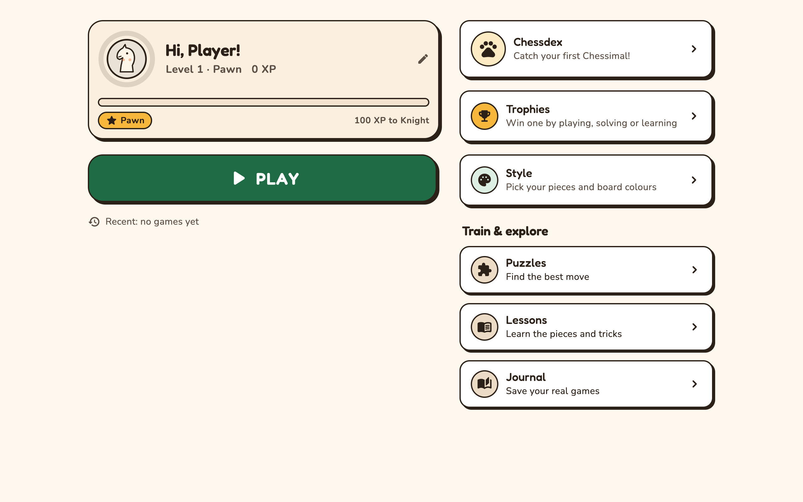
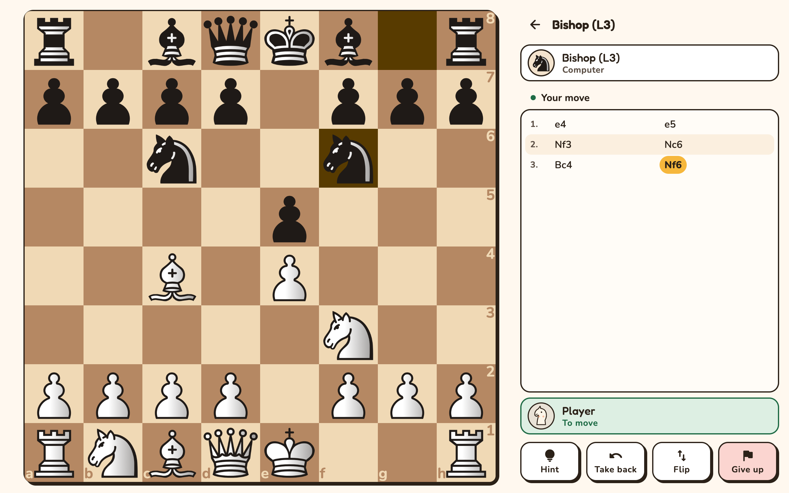
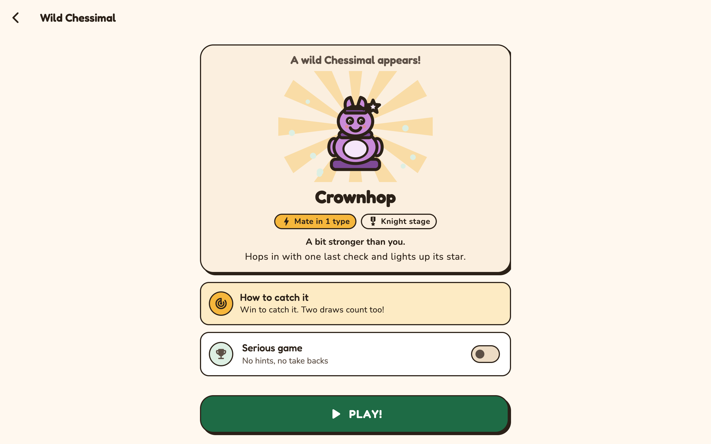
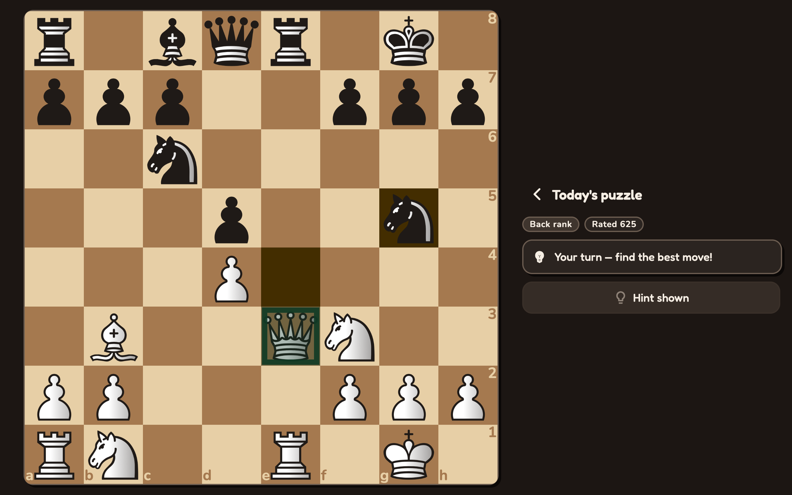
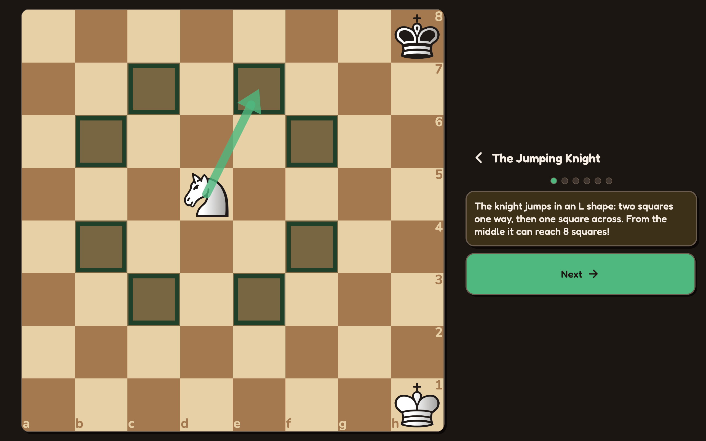
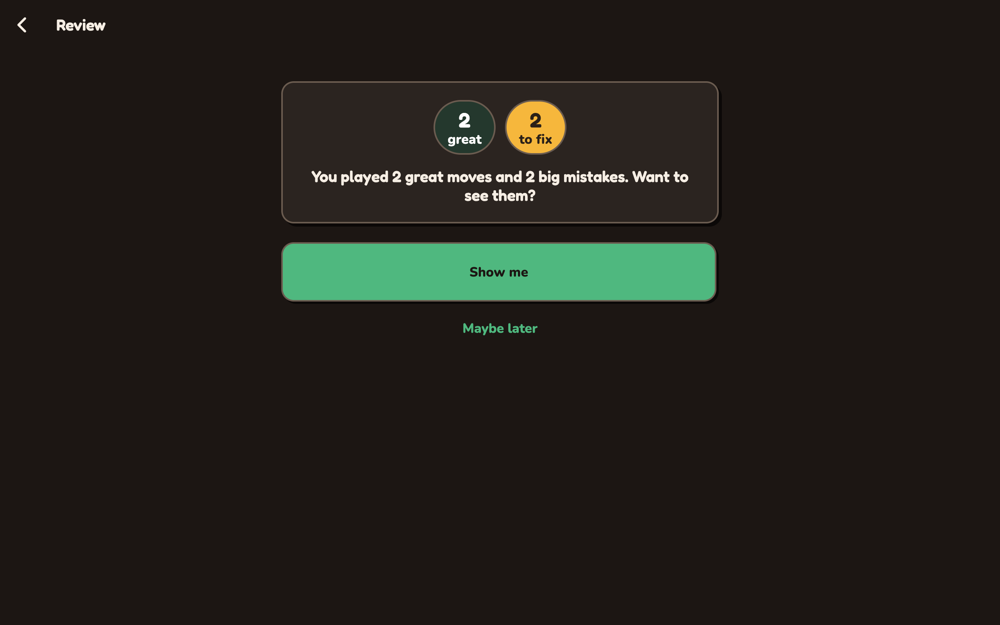

# Chessimal — Downloads

Chess gamified like monsters: catch, train and evolve Chessimals by playing real chess.
Built for one kid, shared for anyone who wants it.

**→ [chessimal.com](https://chessimal.com)**

This repository holds **desktop builds only**. There is no source code here — Chessimal is
closed source. Grab a build from [Releases](../../releases/latest).

| Platform | File | Notes |
|---|---|---|
| macOS 14+ | `Chessimal.dmg` | **Not signed or notarised yet.** macOS refuses it on the first try — open **System Settings → Privacy & Security**, scroll down, and choose **Open Anyway**. |
| Windows 10/11 (x64) | `Chessimal-windows-x64.zip` | Not published yet — the Windows port has not been compiled. |

Android and iOS builds are not published here.

## Screenshots

Every screenshot is drawn by the app itself, by the integration-test harnesses in the source
tree — nothing here is a mockup or a touched-up render.

| | |
|---|---|
|  |  |
| **Home** — level, XP and everything one tap away | **Play** — the board, a clock and a Chessimal opponent |
|  |  |
| **Encounter** — beat a wild Chessimal to catch it | **Puzzles** — a daily puzzle and tactic themes |
|  |  |
| **Lessons** — 24 of them, written for ages 7–10 | **Review** — what went well, what to look at again |

## What it does

- Play real chess against opponents that play like people, not like a machine
- Daily puzzles, a chapter-based lesson curriculum, and a game journal with review
- Fully offline — nothing here needs an account or a network connection
- No ads, no chat, no strangers, no purchases, no tracking

## Reporting a problem

Open an [issue](../../issues) with your OS version and what happened. This is a small
personal project, so fixes come when they come.

## Licence

The binaries are covered by [LICENSE](LICENSE) — free to download and use, not free to
redistribute or modify. Third-party components are listed in
[THIRD-PARTY-NOTICES.md](THIRD-PARTY-NOTICES.md).
